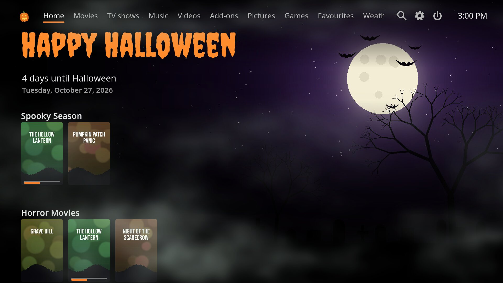
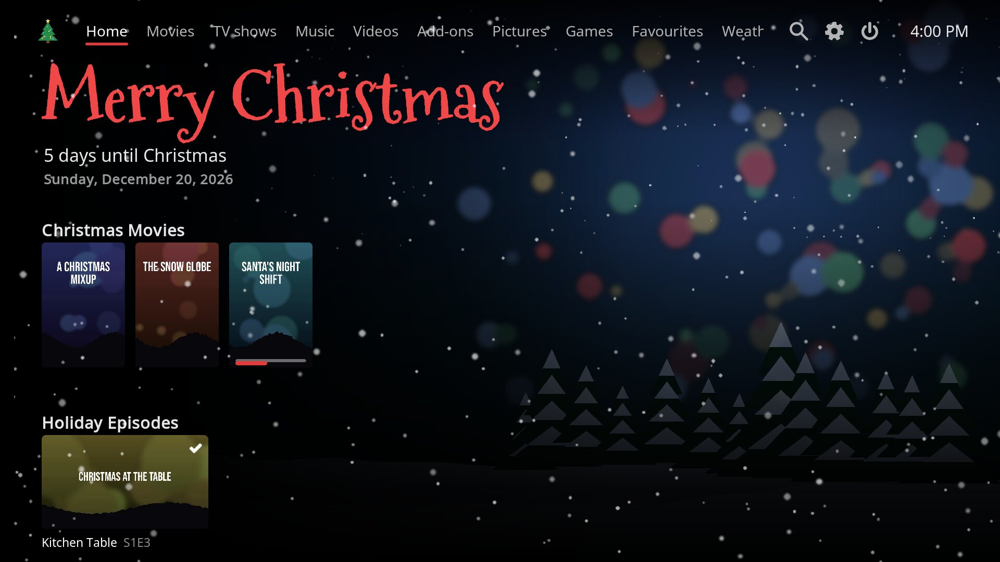
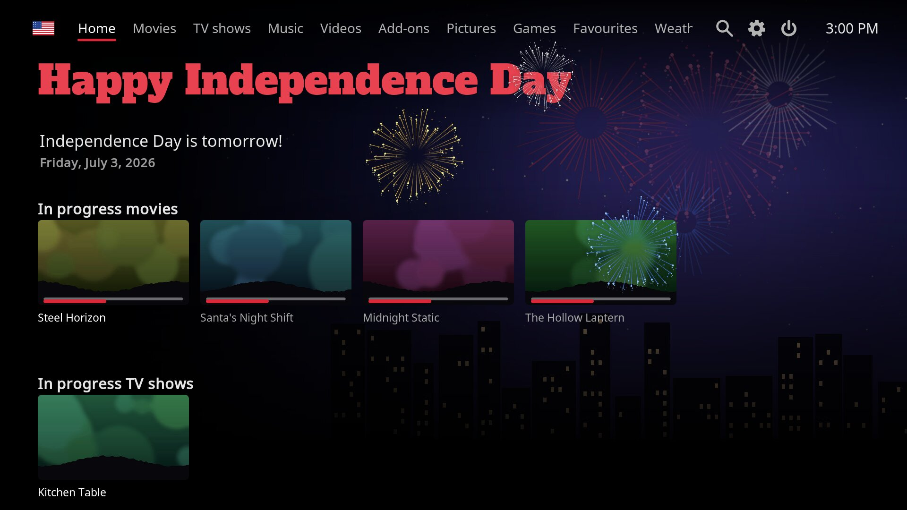
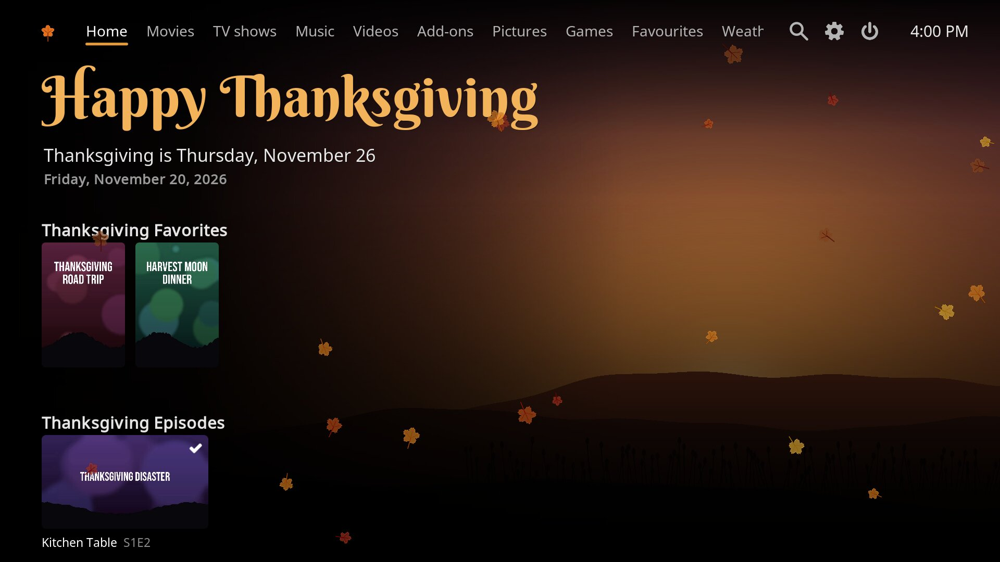
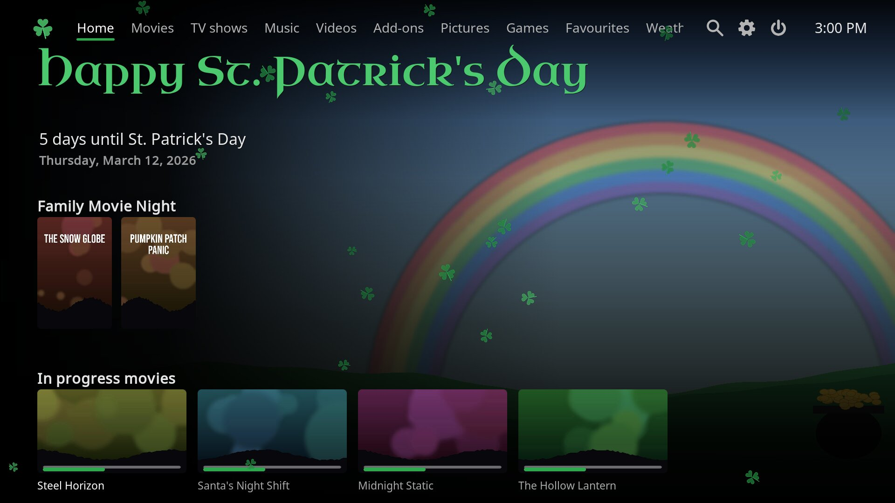
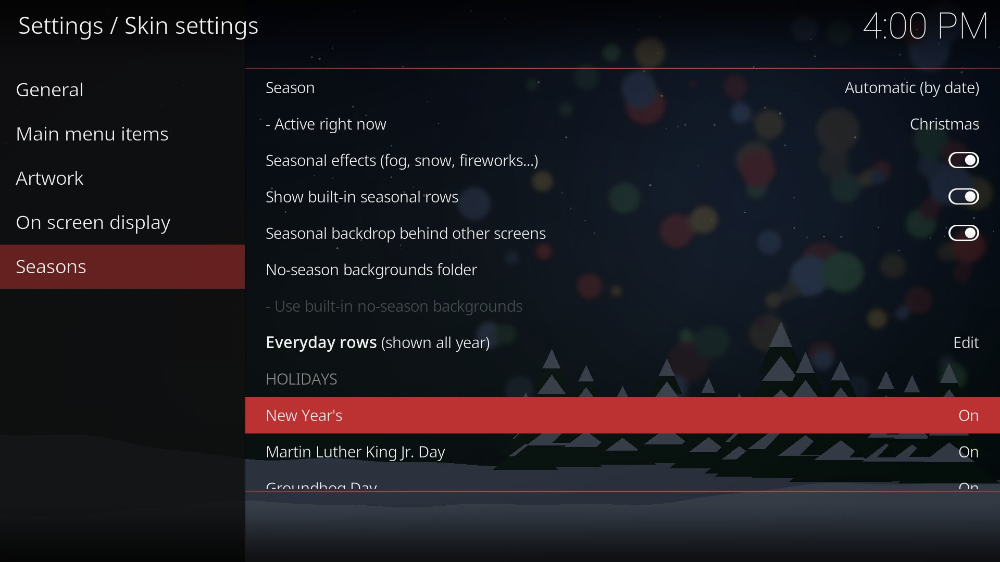
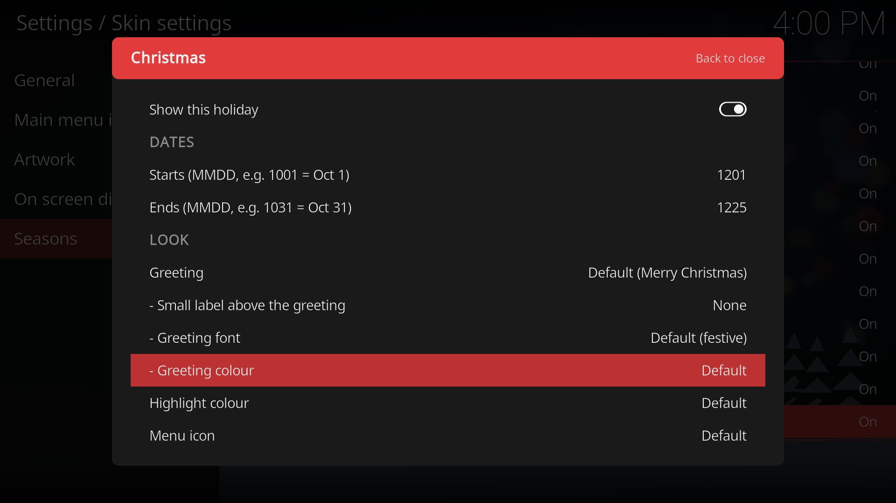

# Marquee

A seasonal, streaming-style skin for Kodi 21 "Omega" and newer, including CoreELEC.

Marquee has a menu along the top, a large hero area for the focused title, and rows of artwork underneath. The whole look follows the calendar. Each of its 19 holidays has its own greeting, colours, backdrop, countdown, effect and rows of matching movies and shows from your library. Everything about each holiday can be changed, and you can add holidays of your own.



| | |
|---|---|
|  |  |
|  |  |
|  |  |

## Install

1. Download the latest zip from [Releases](https://github.com/SeadogMcGrog/skin.marquee/releases), or click **Code → Download ZIP** on this page.
2. In Kodi, go to **Settings → Add-ons → Install from zip file** and pick the zip. Turn on *Unknown sources* if Kodi asks.
3. Go to **Settings → Interface → Skin** and choose **Marquee**.

On CoreELEC, the CoreELEC settings tile appears in the Settings menu, and the power menu has *Restart Kodi* and *Reboot from eMMC/NAND*.

## The holidays

| Default dates | Holiday | Effect |
|---|---|---|
| Dec 26 – Jan 1 | New Year's | Confetti. On Dec 31, a live countdown, a ball drop through the last minute and fireworks at midnight |
| The week up to the 3rd Monday of January | Martin Luther King Jr. Day | None |
| Jan 27 – Feb 2 | Groundhog Day | Falling snow |
| Feb 3 – Feb 14 | Valentine's Day | Rising hearts |
| After Valentine's Day, up to the 3rd Monday of February | Presidents' Day | None |
| Mar 1 – Mar 17 | St. Patrick's Day | Falling shamrocks |
| The month Easter Sunday falls in | Easter | Drifting petals |
| The week up to the 2nd Sunday of May | Mother's Day | Drifting petals |
| The week up to the last Monday of May | Memorial Day | None |
| Jun 13 – Jun 19 | Juneteenth | Fireworks |
| The week up to the 3rd Sunday of June | Father's Day | None |
| Jul 1 – Jul 31 | Independence Day | Fireworks |
| The week up to the 1st Monday of September | Labor Day | None |
| Sep 13 – Sep 19 | Talk Like a Pirate Day | None |
| The weekend of the 2nd Monday of October | Columbus Day | None |
| Oct 1 – Oct 31 | Halloween | Rolling graveyard fog |
| Nov 8 – Nov 11 | Veterans Day | None |
| Nov 1 – Thanksgiving Day | Thanksgiving | Falling leaves |
| Dec 1 – Dec 25 | Christmas | Falling snow |

Holidays that move are worked out for every year from 2024 to 2060. When two overlap, the one coming up next takes over until its day has passed, then the longer season returns. Any other day gets the default look.

## Customising the holidays

Go to **Settings → Interface → Skin → Configure skin → Seasons**.

The top of the page has the global options: force any season (handy for previewing), switch effects, built-in rows and the dimmed backdrop behind other screens on or off, pick a backgrounds folder for days with no holiday, and set up **Everyday rows**, which show all year.

Below that, select any holiday to open its own settings page:

* **Show this holiday**: turn it off and its days go to the next holiday, or to no season.
* **Dates**: fixed-date holidays take a start and end as MMDD (`1001` is Oct 1). Moving holidays let you choose how many days before and after the day the theme runs.
* **Look**: greeting, small label above it, greeting font and colour, highlight colour, menu icon and its animation (still, rock, bob, pulse or spin), backgrounds folder, and effect (fog, snow, leaves, petals, hearts, shamrocks, confetti, fireworks or none).
* **Rows on the home screen**: the built-in rows switch, and five rows of your own. Each takes a title, a video or music smart playlist or any Kodi path, and a tile style (Poster, Landscape or Square).
* **Reset this holiday to its defaults**.

**Your own holidays** has five slots with all the same options, plus a name and a line under the greeting. When one of your holidays overlaps a built-in one, yours wins.

### Built-in rows

Built-in rows use the smart playlists in `playlists/mq_*.xsp`. They match on genre, title, plot keywords and tags. To put a film in a seasonal row for sure, give it one of these tags in Kodi: `halloween`, `thanksgiving`, `christmas`, `easter`, `faith`, `military`, `patriotic`, `valentine`, `irish`, `new year`, `groundhog` or `time loop`.

To make your own smart playlist, go to **Movies → Playlists → New smart playlist**, add rules such as *Genre is Horror* or *Tag is christmas*, save it, then choose it for a row.

### Your own backgrounds

Put your images in a folder on the box or a network share, then point the holiday's **Backgrounds folder** at it. Images in a folder rotate every 25 seconds. Use 1920×1080 JPG or PNG images and keep the left third fairly dark so the text stays readable. Folders outside the skin survive skin updates.

## Add-ons on the top menu

Go to **Configure skin → Main menu items** and scroll to the bottom. There are three add-on slots. Pick any installed add-on, optionally rename it, and optionally show its top-level menu as a row on the home screen.

## Building from source

The home screen, the seasonal logic, the settings pages and the built-in playlists are generated. The generators are in `tools/` and need Python 3 with Pillow and NumPy.

```
python3 tools/gen_xml.py .            # xml/Home.xml, Includes_Marquee*.xml, Custom_1190_MqHoliday.xml, playlists
python3 tools/gen_textures.py . FONTS # effects, icons and UI textures (FONTS = folder of the source .ttf files)
python3 tools/gen_backdrops.py .      # placeholder backdrops in extras/seasons/
```

Holidays, colours, greetings, fonts and date windows are defined at the top of `tools/gen_xml.py`.

## Credits and licences

* Marquee is a derivative of **Estuary** by phil65, Ichabod Fletchman and Team Kodi. Code is GPL-2.0-or-later and artwork is CC-BY-SA-4.0. See [LICENSE.txt](LICENSE.txt).
* CoreELEC settings items are adapted from CoreELEC's build of Estuary.
* Bundled fonts: Bebas Neue, Creepster, Berkshire Swash, Pacifico, Alfa Slab One, Cinzel Decorative, Great Vibes, Uncial Antiqua, Limelight and Pirata One (SIL Open Font License 1.1), Mountains of Christmas (Apache 2.0), and Noto Sans and Roboto from Estuary. See the licence files in `fonts/`.
* The seasonal effects, icons and placeholder backdrops were made for this skin.
